# Mini NPU Simulator

## 1. 프로젝트 소개

본 프로젝트는 Python을 이용하여 간단한 NPU(Neural Processing Unit)의 연산 과정을 구현하는 프로젝트이다.

2차원 행렬과 Cross, X 두 종류의 필터를 이용하여 MAC(Multiply-Accumulate) 연산을 수행하고, 계산된 점수를 비교하여 입력 패턴을 판별한다.

프로그램은 다음 두 가지 실행 모드로 구성되어 있다.

- 사용자 입력 모드: 사용자가 직접 3×3 행렬을 입력하고 결과를 확인한다.
- JSON 분석 모드: 제공된 JSON 파일을 읽어 다양한 크기의 행렬을 자동으로 분석한다.

## 2. 개발 환경

| 항목 | 사용 환경 |
|---|---|
| 운영체제 | Windows 10 Education 22H2 |
| 실행 환경 | Ubuntu (WSL 2) |
| 프로그래밍 언어 | Python 3 |
| 개발 도구 | Visual Studio Code |
| 데이터 형식 | JSON |
| 외부 라이브러리 | 사용하지 않음 |

## 3. 프로젝트 파일 구성

```text
mini-npu-simulator/
├── main.py
├── data.json
├── README.md
└── evidence/
    ├── 01_mac_calculation.png
    ├── 02_filter_comparison.png
    ├── 03_undecided.png
    ├── 04_cross.png
    ├── 05_performance_3x3.png
    ├── 06_json_load.png
    ├── 07_json_mac_test.png
    ├── 08_json_test_results.png
    ├── 09_user_input_mode.png
    ├── 10_json_test_summary.png
    ├── 11_performance_analysis.png
    └── 12_input_validation.png
```

## 4. 주요 구현 내용

### 4-1. MAC 연산

MAC(Multiply-Accumulate)은 두 행렬의 같은 위치에 있는 값을 곱한 후 모든 결과를 더하는 연산이다.

중첩 반복문을 사용하여 행렬의 각 원소를 계산하도록 구현했다.

NumPy와 같은 외부 라이브러리 없이 Python의 반복문을 이용했다.

### 4-2. 필터 비교 및 패턴 판별

Cross 필터와 X 필터를 각각 입력 패턴에 적용하여 MAC 점수를 계산한다.

두 점수를 비교하여 입력 패턴이 Cross인지 X인지 판별한다.

두 점수의 차이가 1e-9보다 작으면 부동소수점 오차를 고려하여 동점으로 처리한다.

컴퓨터의 부동소수점 계산에서는 0.9와 0.8999999999999999처럼 실제로 거의 같은 값에도 아주 작은 차이가 발생할 수 있으므로, 1e-9를 허용 오차로 사용한다.


사용자 입력 모드에서는 동점일 때 '판정 불가'를 출력하고, JSON 분석 모드에서는 'UNDECIDED'를 반환한다. JSON 모드에서 동점 결과가 예상 라벨과 일치하지 않으면 FAIL로 처리한다.

### 4-3. 사용자 입력 모드

사용자가 직접 Cross 필터, X 필터, 입력 패턴을 입력할 수 있다.

각 행렬의 MAC 점수를 계산하고 최종 판정 결과를 출력한다.

### 4-4. JSON 분석 모드

과제에서 제공된 `data.json` 파일을 읽어 테스트 데이터를 자동으로 분석한다.

5×5, 13×13, 25×25 크기의 행렬을 처리하며, 각 테스트의 예상 결과와 실제 결과를 비교하여 PASS 또는 FAIL을 출력한다.

### 4-5. 입력값 검증 및 예외 처리

잘못된 입력이 들어오더라도 프로그램이 종료되지 않도록 예외 처리를 적용했다.

- 숫자가 아닌 값이 입력된 경우 다시 입력하도록 안내한다.
- 행에 숫자가 3개가 아닌 경우 다시 입력하도록 안내한다.
- JSON 테스트 데이터 처리 중 오류가 발생하면 해당 테스트의 실패 원인을 출력하도록 처리했다.

### 4-6. 성능 측정

MAC 연산을 10회 반복하여 평균 실행 시간을 측정한다.

행렬 크기에 따른 연산 횟수를 계산하고 실행 시간과 비교한다.

## 5. 실행 방법

프로젝트 폴더에서 다음 명령어를 실행한다.

```bash
python3 main.py
```

실행 후 모드를 선택한다.

- 1: 사용자 입력 모드
- 2: JSON 분석 모드

## 6. 구현 과정 및 증거 자료

### 6-1. MAC 연산 구현

행렬의 같은 위치에 있는 값을 곱하고 누적하여 최종 점수를 계산하는 MAC 연산을 구현했다.

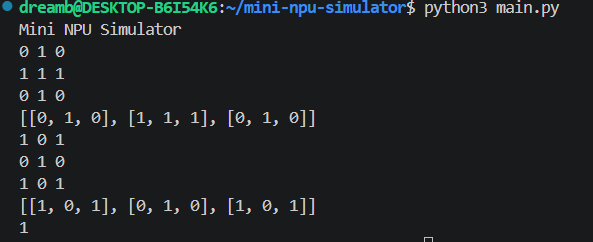

### 6-2. 필터 비교

Cross 필터와 X 필터를 이용하여 입력 패턴의 점수를 비교했다.

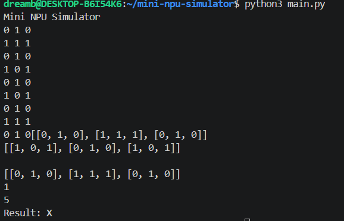

### 6-3. 동점 판정

두 필터의 계산 점수가 같거나 매우 가까운 경우 `UNDECIDED`로 판정하는 기능을 확인했다.

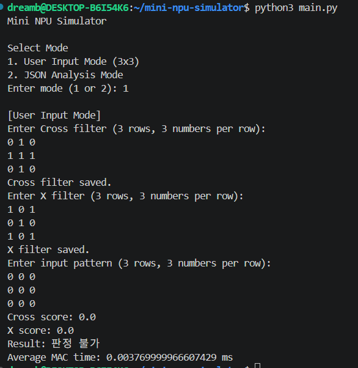

### 6-4. Cross 판정

Cross 필터의 점수가 더 높을 때 Cross로 판정되는 것을 확인했다.

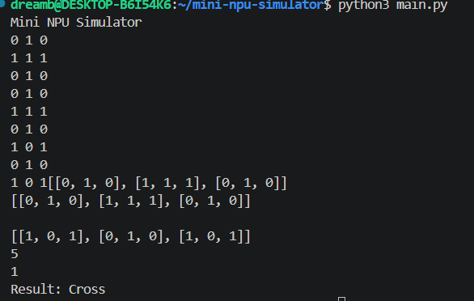

### 6-5. 3×3 행렬 성능 측정

사용자 입력 모드에서 MAC 연산의 실행 시간을 측정했다.

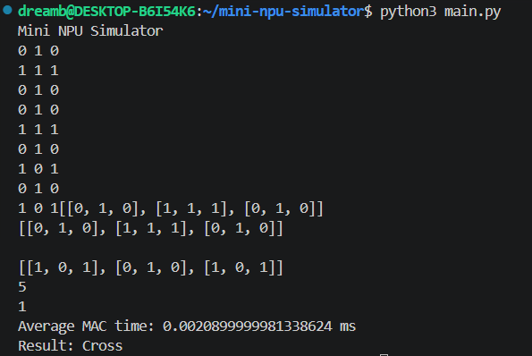

### 6-6. JSON 데이터 불러오기

과제에서 제공된 JSON 파일을 읽어 데이터를 불러오는 과정을 확인했다.

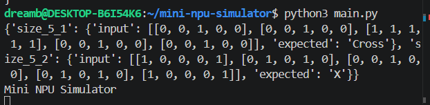

### 6-7. JSON 기반 MAC 테스트

JSON에 저장된 행렬 데이터를 이용하여 MAC 연산을 수행했다.

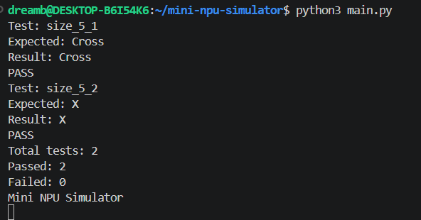

### 6-8. JSON 테스트 실행 결과

여러 테스트 데이터를 대상으로 Cross와 X 판정 결과를 확인했다.

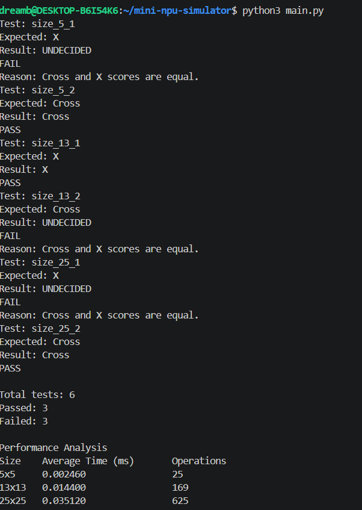

### 6-9. 최종 사용자 입력 모드

최종 프로그램에서 사용자 입력 모드를 실행하고 정상적으로 결과가 출력되는 것을 확인했다.

- Cross score: 5.0
- X score: 1.0
- Result: Cross

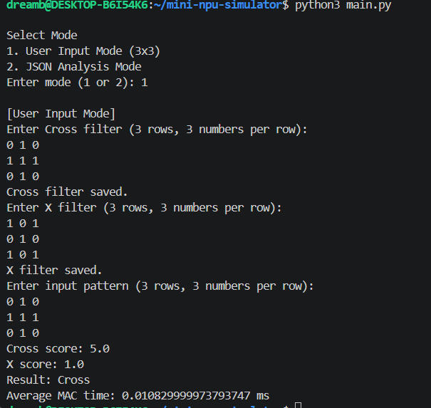

### 6-10. 최종 JSON 분석 결과

최종 프로그램에서 JSON 분석 모드를 실행했다.

총 6개의 테스트를 수행했으며 결과는 다음과 같다.

- 전체 테스트: 6개
- 성공: 3개
- 실패: 3개

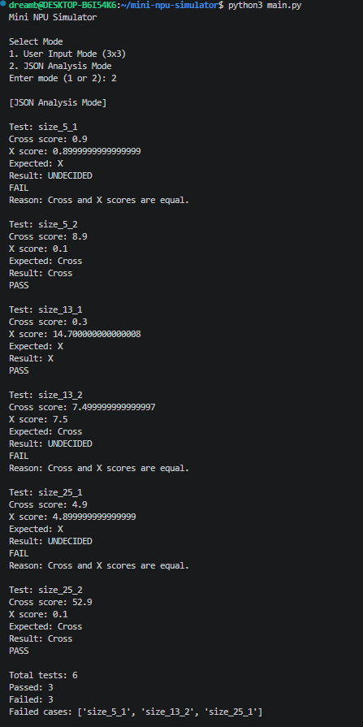

### 6-11. 최종 성능 분석

MAC 연산을 10회 반복하여 평균 실행 시간을 측정했다.

| 행렬 크기 | 평균 실행 시간(ms) | 연산 횟수 |
|---|---:|---:|
| 5×5 | 0.004020 | 25 |
| 13×13 | 0.015480 | 169 |
| 25×25 | 0.053220 | 625 |

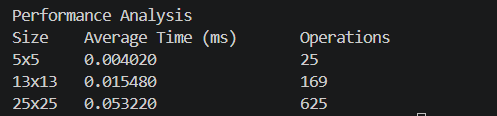

### 6-12. 입력값 검증 테스트

잘못된 입력을 입력했을 때 프로그램이 종료되지 않고 다시 입력을 요청하는지 확인했다.

숫자가 아닌 문자와 잘못된 개수의 숫자를 입력한 후 올바른 값을 입력하여 정상적으로 연산되는 것을 확인했다.

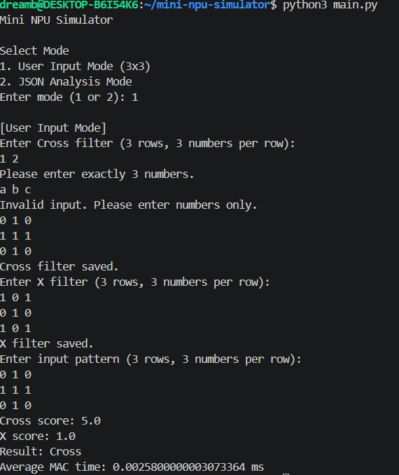

## 7. 테스트 결과 및 실패 원인 분석

최종 JSON 분석 결과는 다음과 같다.

| 항목 | 결과 |
|---|---:|
| 전체 테스트 | 6개 |
| PASS | 3개 |
| FAIL | 3개 |

실패한 테스트는 다음과 같다.

- `size_5_1`
- `size_13_2`
- `size_25_1`

해당 테스트에서는 Cross와 X의 점수가 같거나 매우 근접하게 계산되었다.

프로그램은 두 점수의 차이가 `1e-9`보다 작으면 동점으로 판단하도록 구현되어 있다.

따라서 해당 테스트들은 `UNDECIDED`로 판정되었고, 제공된 예상 결과와 일치하지 않아 FAIL로 표시되었다.

이는 구현한 동점 판정 규칙에 따른 결과이며, 실제 계산 결과와 판정 과정을 확인했다.

## 8. 시간 복잡도 및 성능 분석

MAC 연산은 두 개의 중첩 반복문을 사용한다.

행렬의 크기가 N×N일 때 모든 원소를 한 번씩 계산하므로 연산 횟수는 다음과 같다.

**N × N = N²**

따라서 시간 복잡도는 **O(N²)**이다.

행렬 크기가 증가할수록 연산 횟수도 제곱에 비례하여 증가한다.

예를 들어 행렬 크기가 25×25에서 100×100으로 증가하면 연산 횟수는 625회에서 10,000회로 증가한다. 즉, 행렬 한 변의 길이가 4배가 되면 전체 연산량은 16배가 된다.

실제 성능 측정에서도 행렬 크기가 커질수록 평균 실행 시간이 증가하는 것을 확인했다.

성능 측정은 MAC 연산을 10회 반복하여 평균을 계산했으며, 파일 입출력 시간은 제외했다.

| 행렬 크기 | 평균 실행 시간 (ms) | 연산 횟수 |
|---|---:|---:|
| 5×5 | 0.003300 | 25 |
| 13×13 | 0.013930 | 169 |
| 25×25 | 0.047990 | 625 |

## 9. 추가 분석 및 개선 방향

### 9-1. 새로운 라벨 추가 방법

새로운 패턴 라벨을 추가하려면 여러 부분을 함께 수정해야 한다.

1. `normalize_label()` 함수에 새로운 라벨과 표준 이름의 대응 관계를 추가한다.
2. `data.json`에 새로운 라벨에 해당하는 필터와 테스트 데이터를 추가한다.
3. `classify()` 함수를 확장하여 새로운 라벨까지 비교할 수 있도록 수정한다.
4. 새로운 라벨에 대한 테스트를 수행하여 정상적으로 판별되는지 확인한다.

현재 프로그램은 Cross와 X 두 종류만 판별하도록 구현되어 있다. 따라서 새로운 라벨을 추가하려면 라벨 정규화뿐 아니라 점수 계산과 결과 판정 구조도 함께 확장해야 한다.

### 9-2. 대규모 행렬 처리 시 최적화 방법

현재 MAC 연산은 N×N 행렬의 모든 원소를 순서대로 계산한다.

행렬 크기가 커지면 연산량과 메모리 사용량이 증가할 수 있다.

개선 방법은 다음과 같다.

- 블록 처리: 행렬을 작은 영역으로 나누어 처리한다.
- 병렬 처리: 여러 연산을 동시에 실행한다.
- 메모리 최적화: 불필요한 데이터 복사를 줄인다.
- 반복 연산 최적화: 동일한 계산을 불필요하게 반복하지 않도록 개선한다.

### 9-3. CPU와 NPU의 연산 방식 차이

CPU는 다양한 종류의 작업을 처리하는 범용 프로세서이다.

NPU는 인공지능 연산에 특화된 프로세서로, 많은 행렬 연산을 병렬로 처리하도록 설계되어 있다.

| 구분 | CPU | NPU |
|---|---|---|
| 주요 목적 | 범용 작업 처리 | 인공지능 연산 |
| 연산 방식 | 비교적 순차적인 처리 | 대규모 병렬 처리 |
| 강점 | 다양한 작업에 유연하게 대응 | 행렬 및 MAC 연산에 효율적 |
| 활용 분야 | 운영체제, 일반 프로그램 | 이미지 인식, 음성 인식, AI 추론 |

이번 프로젝트는 Python 반복문을 이용해 MAC 연산을 순차적으로 구현했다.

실제 NPU는 전용 하드웨어를 이용해 여러 연산을 병렬로 수행할 수 있다는 차이가 있다.

## 10. 프로젝트를 통해 학습한 내용

이번 프로젝트를 통해 다음 내용을 실습했다.

- Python 함수와 반복문의 활용
- 2차원 리스트를 이용한 행렬 연산
- MAC 연산의 원리
- JSON 파일 읽기 및 데이터 처리
- 예외 처리를 통한 입력 오류 대응
- 조건문을 이용한 결과 판정
- 부동소수점 오차와 동점 처리
- 반복 측정을 통한 실행 시간 분석
- 시간 복잡도 O(N²)의 의미

## 11. 결론

Mini NPU Simulator 프로젝트를 통해 행렬 기반 MAC 연산과 필터를 이용한 패턴 판별 프로그램을 구현했다.

사용자 입력 모드와 JSON 분석 모드를 구성하고, 입력값 검증과 성능 측정 기능을 추가했다.

또한 실제 테스트를 통해 프로그램의 실행 결과를 확인하고, 동점 판정으로 인해 발생한 실패 원인을 분석했다.

이번 프로젝트를 통해 Python을 활용한 데이터 처리, 반복 연산, JSON 활용 및 간단한 성능 분석 과정을 실습했다.
